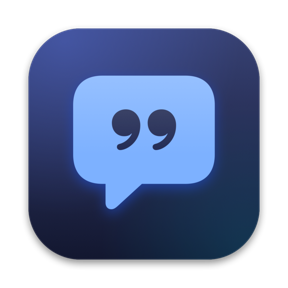

<p align="center">
  
</p>

<h1 align="center">Dialog</h1>

<p align="center">
  A native macOS call assistant that hears the conversation and suggests answers from your own materials.
</p>

<p align="center">
  <strong><a href="https://github.com/soqowa/dialogue/releases/latest">Download for Mac</a></strong>
  &nbsp;·&nbsp; <a href="#quick-start">Quick&nbsp;start</a>
  &nbsp;·&nbsp; <a href="#build-from-source">Build&nbsp;guide</a>
</p>

Dialog (Диалог) listens to system audio and your microphone, transcribes speech on your Mac, and drafts a reply grounded in your materials through your **Codex** subscription (sign in with ChatGPT). No API key is needed, and nothing joins the call.

## Features

- **Any call.** Captures all system audio (Zoom, Telegram, a browser, and so on) and your microphone separately. Lines are labeled “Me” and “Other side”.
- **On-device speech recognition.** Parakeet TDT v3 (CoreML / Neural Engine), GigaAM v3, Whisper Large v3 Turbo and Base (MLX). Audio never leaves your Mac.
- **Answers from your materials.** PDF, DOCX, Markdown, TXT, source code, and whole folders. Citation numbers in an answer open the original passage.
- **Auto-reply or on demand.** A global shortcut (⌃⌥↩ by default) works from any app.
- **Projects.** Each project has its own materials, answer style, model, and conversation history.
- **Interface.** A dark Liquid Glass look on macOS 26 and later, with frosted materials on macOS 14–15. The interface is in Russian.

## Installation

Download `Dialog-*-Apple-Silicon.dmg` from the [latest release](https://github.com/soqowa/dialogue/releases/latest) and drag **Диалог** to Applications. It requires a Mac with **Apple Silicon** and **macOS 14 or later**. Node.js, Python, the Codex CLI, and the speech engines ship inside the DMG. Speech models download the first time you pick an engine.

<details>
<summary>Open an unnotarized build</summary>

The build isn’t notarized by Apple. On first launch, open **System Settings → Privacy & Security** and click **Open Anyway**.

</details>

## Quick start

1. **Sign in to Codex.** In **Settings → Codex and audio** (Настройки → Codex и звук), click **Sign in** (Войти) and sign in to ChatGPT with an account that has Codex access.
2. **Grant permissions.** Allow the microphone and **Screen & System Audio Recording**. Dialog needs it to capture sound and doesn’t record the screen image.
3. **Add materials.** Create a project, add documents or folders, and set the answer style.
4. **Start listening.** Click **Listen** (Слушать). Answers appear automatically or when you press the shortcut.

## Build from source

You need Xcode 26+, Node.js 22+, [`uv`](https://github.com/astral-sh/uv), Python 3.11, `ffmpeg`, and the Codex CLI signed in with ChatGPT.

```sh
npm install
npm run setup:speech
codex login
scripts/build-mac.sh                 # → build/Диалог.app
```

| Script | What it does |
| --- | --- |
| `scripts/install-mac.sh` | Builds and installs `/Applications/Диалог.app` |
| `scripts/install-nightly.sh` | Installs a separate “Диалог Nightly” copy next to the main app |
| `scripts/package-mac.py` | Builds a self-contained DMG in `output/` |

For development, open `native/Package.swift` in Xcode and choose the **Dialog → My Mac** scheme.

<details>
<summary>Run the tests</summary>

```sh
npm test
.venv/bin/python -m unittest discover -s tests -p 'test_speech_*.py'
swift test --package-path native
```

</details>

The app icon is drawn by [`scripts/make-icon.swift`](scripts/make-icon.swift) during the build.

## How it works

```text
System audio (ScreenCaptureKit) ┐
                                ├→ Silero VAD → on-device ASR → “Me” / “Other side” transcript
Microphone (AVAudioEngine) ─────┘                                          ↓
                  materials + search and read tools → codex app-server → answer
```

- `native/` — the SwiftUI app: interface, audio capture, shortcuts.
- `server/` — a local Node.js service (`127.0.0.1:4317`): material import, search, sessions, and the Codex connection.
- `speech/` — a Python worker with the speech engines.
- `public/` — the original browser prototype, kept for debugging.

## Data and privacy

Audio is processed only on your Mac. Codex receives the transcript, your question, your instructions, and the matching passages from your materials. Materials, history, and settings stay local: in `~/Library/Application Support/Dialog` for the DMG build and in `.local/` when running from source. Requests count toward your Codex subscription limits.

## Third-party components

Bundled projects and their licenses are listed in [`third-party/README.md`](third-party/README.md).

## License

[MIT](LICENSE)
